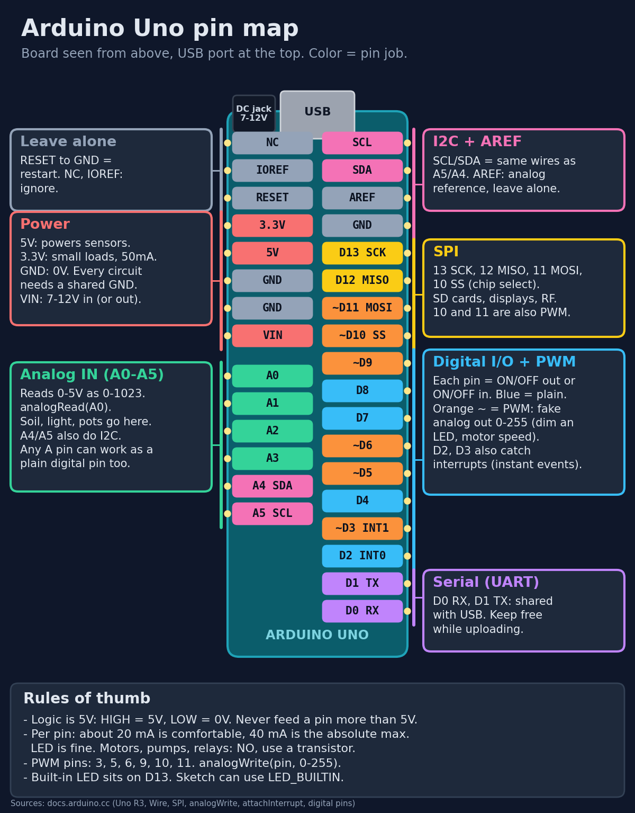
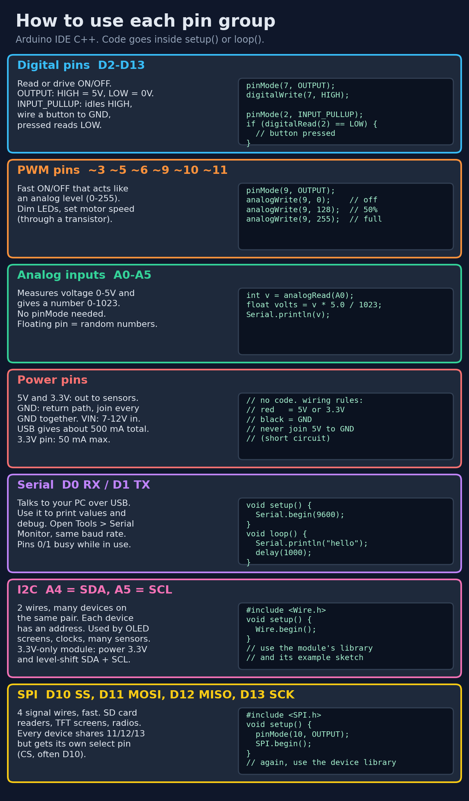
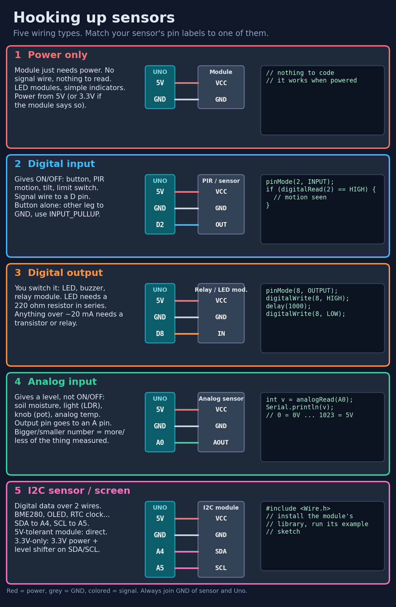
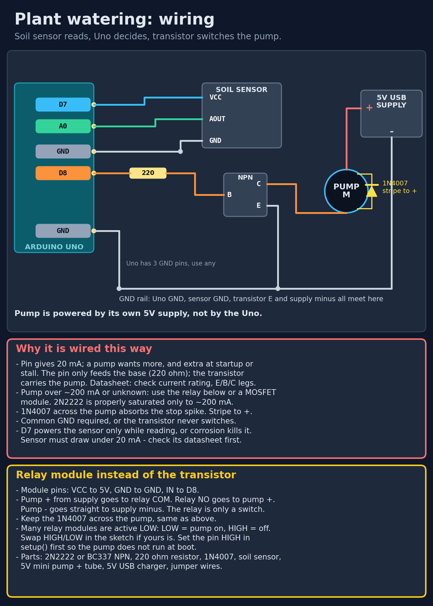
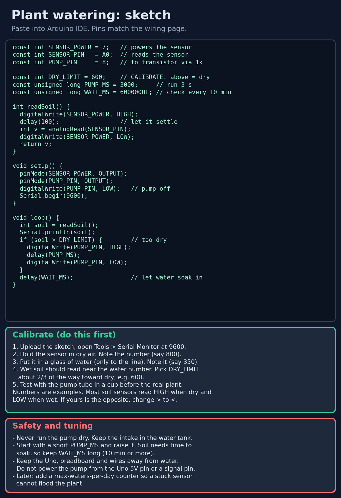

# All about Arduino

Arduino Uno reference charts and a plant-watering build guide.

## Charts

1. **Uno pin map** - every pin, what it does, how to interact with it

   

2. **How to use each pin group** - digital, PWM, analog, power, serial, I2C and SPI, with code snippets

   

3. **Hooking up sensors** - the five wiring types, matched to your sensor's pin labels

   

4. **Plant watering: wiring** - soil sensor reads, Uno decides, transistor switches the pump (relay alternative included)

   

5. **Plant watering: sketch** - paste into Arduino IDE, plus calibration steps

   

## Status

- The watering sketch compiles cleanly for Arduino Uno (checked with arduino-cli, arduino:avr).
- The physical circuit is **not verified on hardware**. Check your exact parts against their datasheets before wiring power: soil sensor current draw, pump current including startup/stall, and transistor ratings.
- `DRY_LIMIT` in the sketch is a placeholder - calibrate with your own sensor first (chart 5 explains how).
